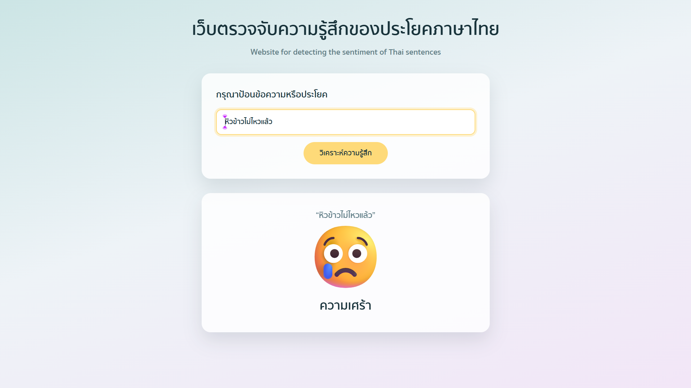

# เว็บตรวจจับอารมณ์จากประโยคภาษาไทย

**Website สำหรับวิเคราะห์ความรู้สึกของข้อความภาษาไทย**

เว็บแอปนี้เป็นโปรเจกต์ที่สร้างด้วย **Flask** สำหรับวิเคราะห์อารมณ์จากประโยคภาษาไทย โดยใช้โมเดล **Naive Bayes** ในการจำแนกความรู้สึก และใช้ **attacut** สำหรับช่วยตัดคำภาษาไทย

ระบบสามารถจำแนกอารมณ์ออกเป็น 4 ประเภท พร้อมแสดงผลเป็นอีโมจิ ได้แก่

- 😄 ความสุข
- 😢 ความเศร้า
- 🥰 ความรัก
- 😡 ความโกรธ

---

## Screenshots



---

## โครงสร้างโปรเจกต์

```
├── app.py                     # ไฟล์หลักของ Flask และ routes ต่าง ๆ
├── config.py                  # จัดการค่าตั้งค่าจากไฟล์ .env
├── sentiment_classifier.py    # โมเดลวิเคราะห์อารมณ์และข้อมูลอีโมจิ
├── train_model.py             # สคริปต์สำหรับเทรนโมเดลใหม่
├── .env.example               # ตัวอย่างไฟล์ตั้งค่า
├── data/
│   └── Thai Emotion.xlsx      # ชุดข้อมูลสำหรับฝึกโมเดล
├── models/                    # เก็บไฟล์โมเดลที่เทรนแล้ว
├── templates/
│   ├── base.html              # โครงสร้างหน้าเว็บหลัก
│   ├── home.html              # หน้าแรก
│   └── components/            # ส่วนประกอบต่าง ๆ ของหน้าเว็บ
└── static/
    ├── css/style.css          # ไฟล์ตกแต่งหน้าเว็บ
    └── fonts/                 # ฟอนต์ที่ใช้ในเว็บไซต์
```

---

## การแก้ไขหรือเพิ่มอารมณ์

หากต้องการเพิ่ม เปลี่ยนชื่อ หรือแก้ไขอีโมจิของอารมณ์ สามารถแก้ได้ที่ตัวแปร `EMOTIONS` ในไฟล์

```
sentiment_classifier.py
```

เพียงไฟล์เดียว ระบบจะนำค่าที่แก้ไขไปแสดงบนหน้าเว็บโดยอัตโนมัติ

---

## วิธีติดตั้ง

ติดตั้ง Library ที่จำเป็นด้วยคำสั่ง

```bash
pip install -r requirements.txt
```

จากนั้นสร้างไฟล์ `.env` จากไฟล์ตัวอย่าง

Windows:

```bash
copy .env.example .env
```

macOS / Linux:

```bash
cp .env.example .env
```

---

## การตั้งค่าไฟล์ `.env`

ไฟล์ `.env` ใช้สำหรับเก็บค่าการตั้งค่าของระบบ

| ตัวแปร | ความหมาย |
|---|---|
| `PORT` | กำหนดพอร์ตสำหรับเปิดเว็บไซต์ (ค่าเริ่มต้น 5001) |
| `FLASK_DEBUG` | เปิดหรือปิด Debug Mode (`1` = เปิด, `0` = ปิด) |

> หมายเหตุ: บน Windows พอร์ต 5000 อาจถูกระบบจองไว้ ทำให้ Flask ไม่สามารถเปิดใช้งานได้  
> หากพบปัญหาให้เปลี่ยนค่า `PORT` เป็นพอร์ตอื่น เช่น 5001

สามารถตรวจสอบพอร์ตที่ถูกจองได้ด้วยคำสั่ง:

```bash
netsh interface ipv4 show excludedportrange protocol=tcp
```

---

## วิธีรันโปรเจกต์

เปิดใช้งาน Flask ด้วยคำสั่ง:

```bash
python app.py
```

จากนั้นเปิดเว็บเบราว์เซอร์ไปที่:

```
http://127.0.0.1:5001
```

เว็บไซต์ก็พร้อมใช้งาน

---

## การทำงานของโมเดล

โมเดลจะถูกเทรนเพียงครั้งเดียว และบันทึกไว้ที่

```
models/sentiment_model.joblib
```

เมื่อเปิดเว็บไซต์ ระบบจะโหลดโมเดลนี้มาใช้งานทันที ทำให้ไม่ต้องอ่านไฟล์ Excel และไม่ต้องประมวลผลข้อมูลใหม่ทุกครั้ง

หากเปิดใช้งานครั้งแรกและยังไม่มีไฟล์โมเดล ระบบจะทำการเทรนโมเดลให้อัตโนมัติ

---

## การเทรนโมเดลใหม่

หากมีการแก้ไขข้อมูลในไฟล์

```
data/Thai Emotion.xlsx
```

สามารถเทรนโมเดลใหม่ได้ด้วยคำสั่ง:

```bash
python train_model.py
```

หลังจากเทรนเสร็จ ระบบจะสร้างโมเดลใหม่และนำไปใช้งานแทนโมเดลเดิม

---
